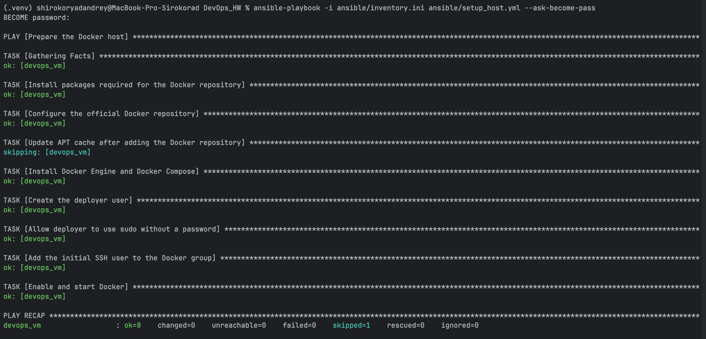
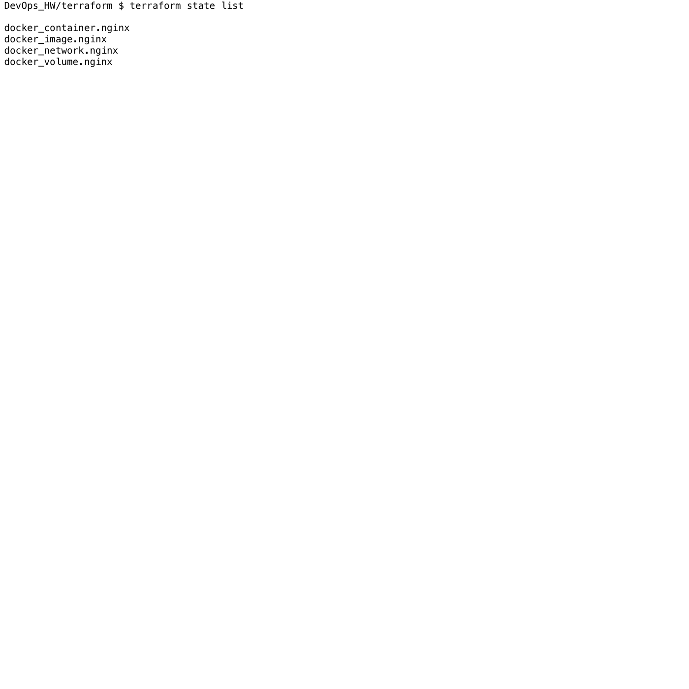
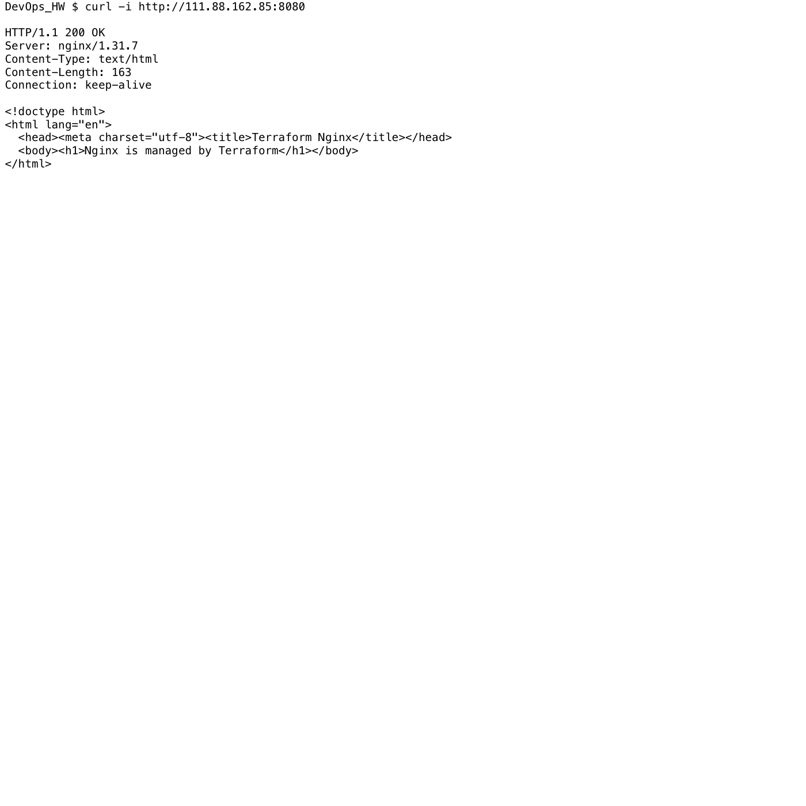
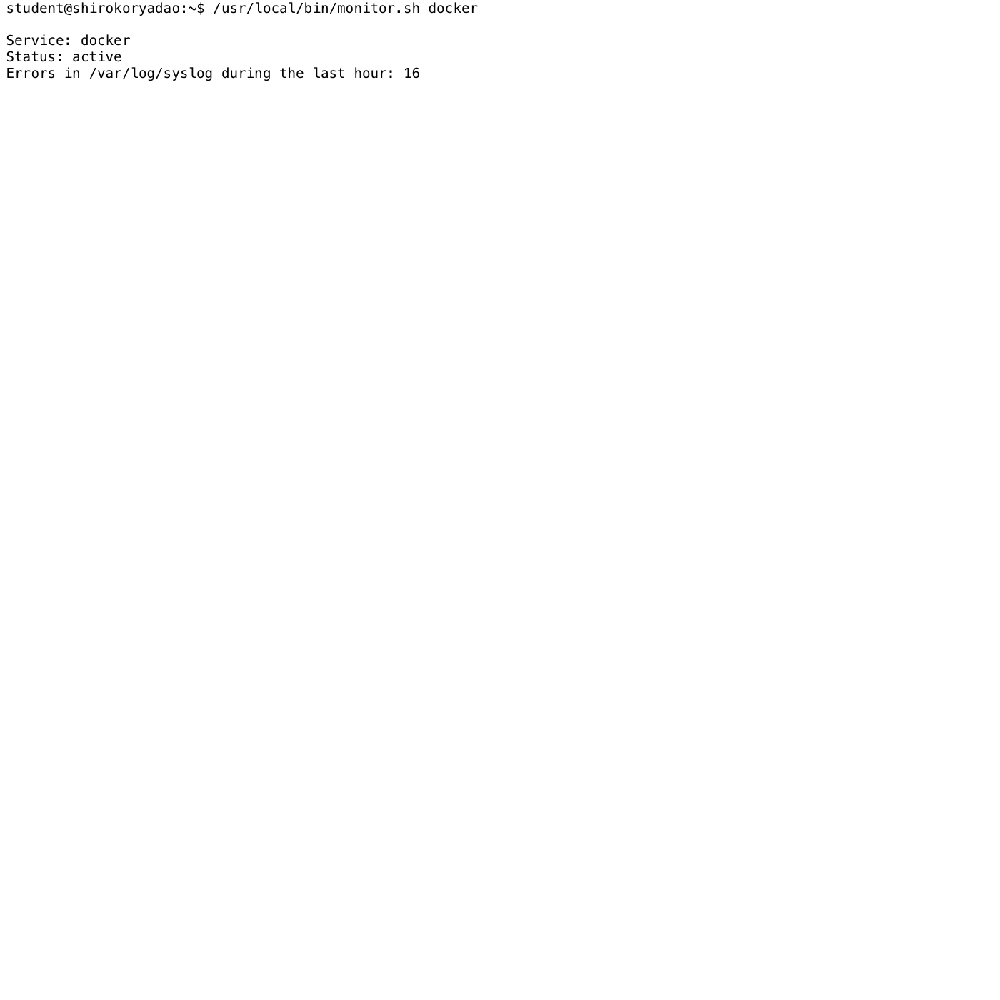
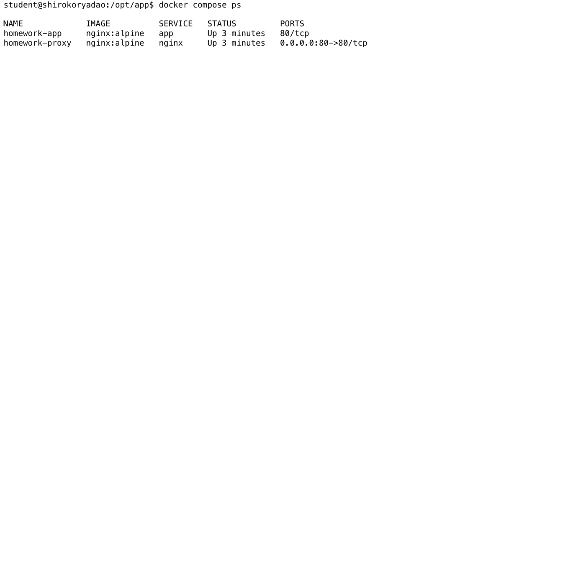
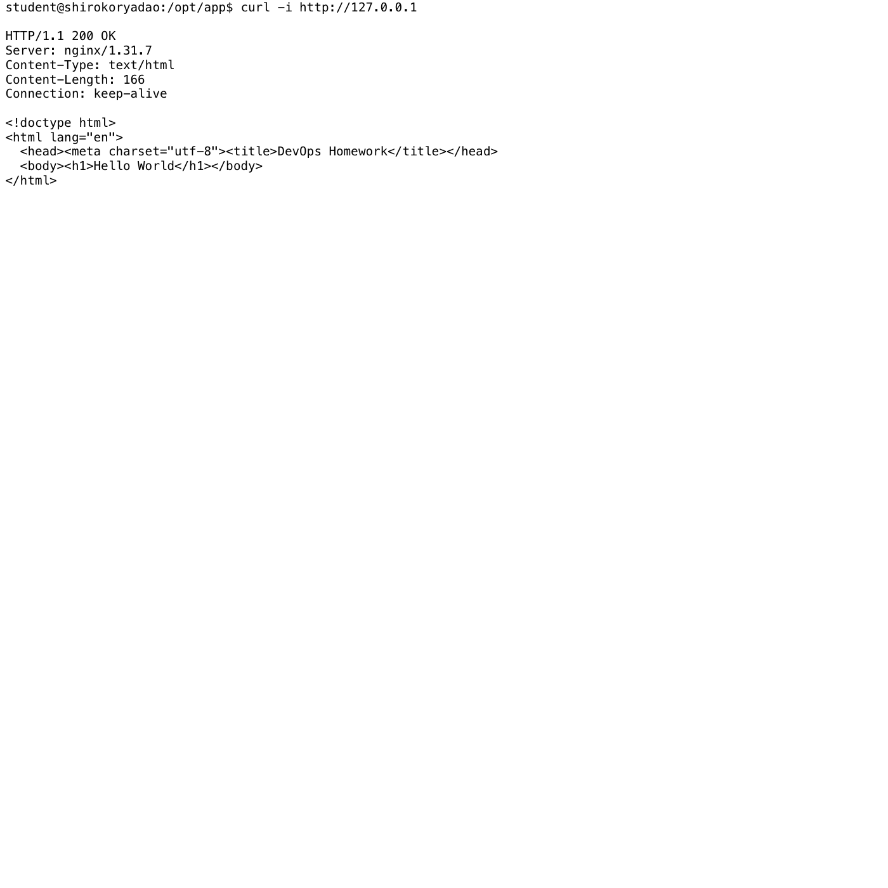

# DevOps Homework: Terraform, Ansible and Docker

Учебный проект подготавливает удалённую Ubuntu VM для работы с Docker и
запускает два независимых контейнерных окружения.

## Архитектура

```text
Mac (Ansible + Terraform)
        |
        | SSH
        v
Ubuntu VM
  |-- terraform_nginx_network
  |     `-- terraform-nginx (порт 8080, Docker volume)
  |
  `-- compose_app_network
        |-- homework-proxy (порт 80)
        `-- homework-app (Hello World)
```

Сначала Ansible устанавливает Docker и настраивает пользователя. После этого
Terraform подключается к Docker API через SSH и создаёт отдельный Nginx,
сеть и том. Docker Compose запускает reverse proxy и приложение в другой сети.

## Структура проекта

```text
.
|-- ansible/
|   |-- inventory.example.ini
|   `-- setup_host.yml
|-- terraform/
|   |-- main.tf
|   |-- variables.tf
|   |-- outputs.tf
|   `-- terraform.tfvars.example
|-- scripts/
|   `-- monitor.sh
|-- compose/
|   |-- docker-compose.yml
|   |-- app/index.html
|   `-- nginx/default.conf
|-- screenshots/
`-- requirements.txt
```

## 1. Подготовка Ansible

Установить зависимости и создать локальный inventory:

```bash
python3 -m venv .venv
source .venv/bin/activate
pip install -r requirements.txt
cp ansible/inventory.example.ini ansible/inventory.ini
```

В `ansible/inventory.ini` указать IP VM и путь к SSH-ключу. Проверить доступ:

```bash
ansible -i ansible/inventory.ini devops_servers -m ping
```

Запустить playbook два раза:

```bash
ansible-playbook -i ansible/inventory.ini ansible/setup_host.yml --ask-become-pass
ansible-playbook -i ansible/inventory.ini ansible/setup_host.yml --ask-become-pass
```

Во втором запуске получено `changed=0`, то есть playbook идемпотентен.



## 2. Terraform с Docker Provider

Реальный `terraform.tfvars` не хранится в Git. Создать его из примера:

```bash
cp terraform/terraform.tfvars.example terraform/terraform.tfvars
```

Указать IP VM и выполнить:

```bash
cd terraform
terraform init
terraform fmt -check
terraform validate
terraform plan
terraform apply
```

Terraform создаёт:

- образ `nginx:alpine`;
- контейнер `terraform-nginx`;
- сеть `terraform_nginx_network`;
- том `terraform_nginx_data`;
- публикацию нестандартного порта `8080` на порт `80` контейнера.

Из-за регионального ограничения HashiCorp Registry тот же провайдер
`kreuzwerker/docker` загружается через совместимый OpenTofu Registry.

Проверка ресурсов и HTTP:

```bash
terraform state list
curl -i http://<VM_IP>:8080
```

Ожидаемый HTTP-статус: `200 OK`.





## 3. Скрипт мониторинга

Скопировать и установить скрипт на VM:

```bash
scp scripts/monitor.sh student@<VM_IP>:/tmp/monitor.sh
ssh student@<VM_IP> 'sudo install -m 0755 /tmp/monitor.sh /usr/local/bin/monitor.sh'
```

Запуск:

```bash
monitor.sh docker
```

Скрипт проверяет сервис через `systemctl is-active`. Для неактивного сервиса
он выводит последние 10 строк `journalctl`, а также считает строки с ошибками
в `/var/log/syslog` за последний час с помощью `grep` и `awk`.



## 4. Docker Compose

Скопировать `compose/` на VM:

```bash
scp -r compose student@<VM_IP>:/tmp/devops-compose
ssh student@<VM_IP> 'sudo mkdir -p /opt/app && sudo cp -R /tmp/devops-compose/. /opt/app/ && sudo chown -R student:student /opt/app'
```

Затем выполнить на VM:

```bash
cd /opt/app
docker compose config
docker compose up -d
docker compose ps
curl -i http://127.0.0.1
```

`homework-proxy` принимает HTTP-запрос на порту `80` и передаёт его контейнеру
`homework-app`. Приложение возвращает страницу `Hello World`.





## Проверка сетей

```bash
docker network inspect terraform_nginx_network
docker network inspect compose_app_network
```

Terraform-контейнер находится только в `terraform_nginx_network`, а Compose
контейнеры находятся только в `compose_app_network`.

## Принятые решения

- Docker API не открыт наружу: Terraform подключается к VM по SSH.
- Для Terraform Nginx используется нестандартный порт `8080`.
- Terraform и Compose используют разные Docker-сети.
- Именованный Docker volume хранит содержимое сайта Terraform Nginx.
- Пароли, ключи, настоящий inventory, `terraform.tfvars` и state исключены из Git.

## Очистка

Terraform-ресурсы:

```bash
cd terraform
terraform destroy
```

Compose-окружение:

```bash
cd /opt/app
docker compose down
```
